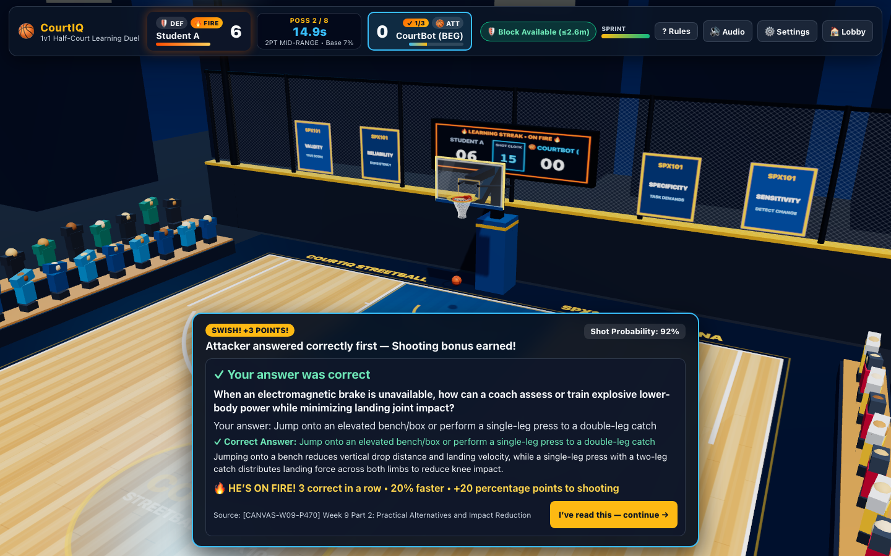
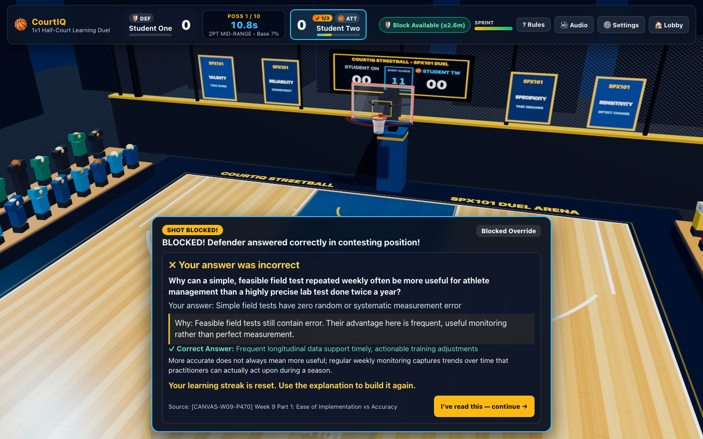
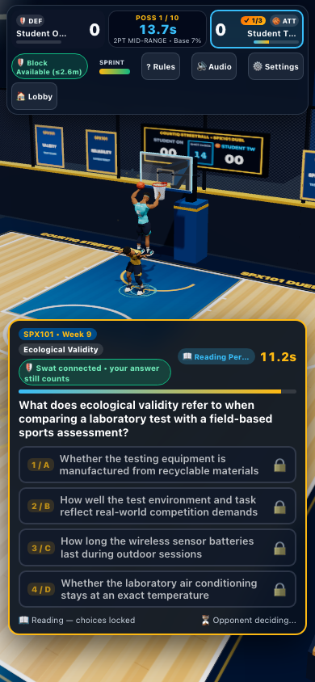

# Simple controls and learning Fire verification

12 November 2026. Source baseline `b6feb63`. The release adds two contextual action keys, random paint-drive dunks, more forgiving manual blocks, personal learning explanations, and Fire after three consecutive correct questions. See the main README for controls and exact rules.

- 124 tests across 17 files pass; strict TypeScript and production build pass.
- Ordinary-input isolated Chromium matches verify all four C tap counts, primary-action paint dunk/manual block, immediate defensive C swipe and root, Fire ignition after three correct answers and reset after the next wrong answer.
- Two browser clients on the deployed preview verify the same question and choices, hidden pre-resolution keys/reasons, different personal verdicts, and both students confirming Continue. The final physical-swat label correction was checked in the compiled local build.
- Desktop, 390×844 portrait and 844×390 landscape controls were checked. Rendered screenshots were opened and inspected. A labelled 64px hosting-badge fixture also clears all four choices and Continue; the preview itself did not inject a real badge.
- All 85 original question records and pack metadata remain unchanged; 255 wrong-choice reasons were added. Those new rationales are **draft additions awaiting instructor review**.

[Machine-readable release evidence](report.json)

Physical mobile devices, campus Wi-Fi, subjective play balance and human audio listening remain untested. These checks do not establish AAA comparability. No paid APIs, asset purchases, new services or extra-credit fallback were used.
